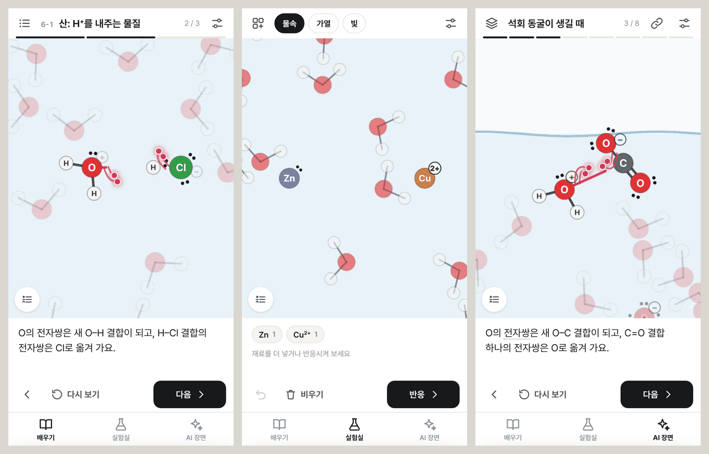
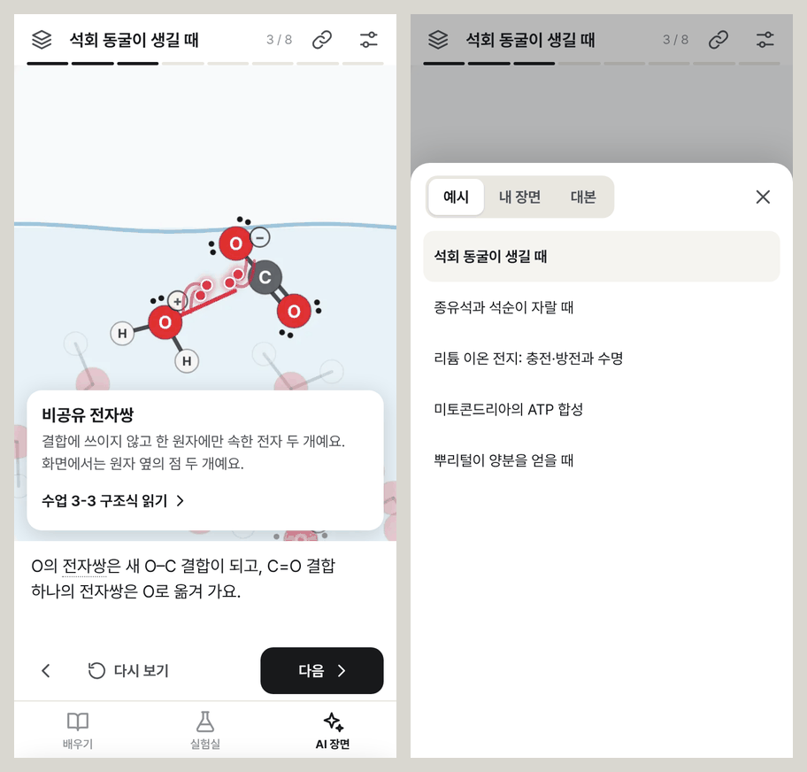

# chemvis 다음 단계 기획안

- 상태: 안. 윤범님이 확인하시기 전이고, 말씀에 따라 고친다.
- 쓴 날: 2026-11-10
- **가장 먼저 할 일은 [반응을 그리는 방식](depiction.md)이다.** 지금의 선과 굽은 화살표는 보자마자 알 수 있는 표현이 아니다. 비교 화면: https://gybeom8008.github.io/chemvis/concept/
- 아래 탭 구성과 화면 배치는 그다음 일이다. 처음에 올렸던 화면 시안은 내렸다(이 문서의 이미지로 남아 있다).

| 문서 | 내용 |
|---|---|
| [depiction.md](depiction.md) | 반응을 그리는 방식: 전자쌍 표현 (가장 먼저) |
| 이 문서 | 세 탭, 탭끼리 이어지는 곳, 이름, AI 장면 탭, 일정, 정하신 것 |
| [curriculum.md](curriculum.md) | 교육 과정: 가르치는 원칙, 수업 한 편의 구조, 8단원 51수업 |
| [lab-astra.md](lab-astra.md) | 실험실 설계서(Astra가 씀): 범위, 환경, 드래그, 판정 절차, 자료 형식, 시험 |
| [lab-review.md](lab-review.md) | 그 설계서의 검토: 그대로 쓰는 것, 고쳐서 쓰는 것 |
| [lab.md](lab.md) | 실험실의 처음 초안. 화면 배치만 참고하고 나머지는 위의 두 문서를 따른다 |
| [lab-brief.md](lab-brief.md) | 실험실의 기획과 설계를 다른 모델에게 맡길 때 준 의뢰서 |
| [ui.md](ui.md) | 화면 구상: 다섯 영역, 규칙 18개, 부품 |
| [handover.md](handover.md) | **인계서.** 클라우드 세션에서 로컬 세션으로 옮길 때 읽는 문서: 지금 상태, 남은 일, Astra와 일하는 방법 |
| [handoff.md](handoff.md) | 다음 주부터 Opus에게 맡겨도 결과가 일정하게 나오게 하는 방법 |

## 1. 무엇을 만드는가

지금의 chemvis는 AI가 쓴 대본을 재생하는 도구다. 여기에 두 가지를 더한다.

- 화학 기초를 처음부터 차례로 배우는 교육 과정
- 원소와 물질을 직접 넣고 반응시켜 보는 실험실

세 화면은 탭으로 나눈다. 세 탭은 같은 무대를 쓰고, 장면을 누가 만드느냐만 다르다.

| 탭 | 장면을 만드는 쪽 | 사용자가 하는 일 |
|---|---|---|
| 배우기 | 교재 | 차례대로 보고, 다음 일을 예측하고, 답을 확인한다 |
| 실험실 | 사용자 | 재료와 조건을 고르고 반응을 본다 |
| AI 장면 | AI | 궁금한 것을 AI에게 묻고, AI가 쓴 장면을 본다 |

무대, 설명 줄, 조작 줄은 세 탭에서 똑같다. 그래서 사용자는 조작법을 한 번만 익히면 되고, 개발도 화면 뼈대 한 벌만 관리하면 된다.

## 2. 탭끼리 이어지는 곳

| 어디에서 | 무엇을 누르면 | 무엇이 나오는가 |
|---|---|---|
| 모든 탭의 설명 | 점선 밑줄이 있는 용어 | 그 용어의 뜻과, 그 용어를 배우는 수업 |
| 배우기의 수업 끝 | 직접 해 보기 | 그 수업의 재료가 들어 있는 실험실 |
| 실험실의 결과 | 수업 이름 | 그 반응을 배우는 수업 |
| 실험실에서 앱이 모르는 조합 | AI에게 묻기 | AI에게 보낼 질문 문장 |
| AI 장면 | 보관 | AI 장면 탭의 '내 장면' 목록 |

이 가운데 첫째 줄이 가장 중요하다. 튜토리얼을 만든 까닭은 AI가 "중화 반응이 일어나요"라고 했을 때 "중화 반응이 뭔데?"라고 되묻지 않게 하려는 것이었다. 용어를 누르면 곧바로 뜻과 수업이 나오면, 그 목적을 화면이 직접 이룬다.

## 3. 이름

**배우기 / 실험실 / AI 장면**으로 정했다(2026-11-10).

- '교육'은 만드는 쪽에서 쓰는 말이다. 그 화면에서 사용자가 하는 일은 '배우기'다.
- '놀이터'와 '실험실' 가운데서는 '실험실'을 추천한다. 재료를 넣고 반응을 보는 곳이라는 뜻이 이름에 그대로 있다. '놀이터'는 덜 딱딱하다는 장점이 있으니, 취향대로 고르시면 된다.
- 'MCP'는 AI와 앱을 잇는 통신 방식의 이름이라, 그 화면에 무엇이 있는지 알려 주지 않는다. 사용자가 그 화면에서 보는 것은 AI가 쓴 장면이다.

## 4. AI 장면 탭

지금 앱의 작업 화면이 이 탭이 된다. 달라지는 것은 세 가지다.

1. 예시, 내 장면, 대본을 서랍 하나에 모은다. 지금은 위쪽 아이콘 다섯 개에 흩어져 있다.
2. '내 장면'이 생긴다. 링크로 본 장면을 브라우저에 보관해 두고 다시 본다. 예전 링크(`#z=`, `#s=`, `#/x/…`)는 그대로 재생된다.
3. 설명 속 용어를 누르면 뜻과 수업이 나온다.

### MCP 연결 (2차)

지금은 AI가 대본을 써서 링크로 준다. 여기에 MCP 서버를 더하면 두 가지가 좋아진다.

- AI가 대본을 보내기 전에 앱의 검사를 거친다. 오류가 난 대본은 AI가 스스로 고친 뒤에 보내므로, 사용자가 오류 화면을 볼 일이 없다.
- 장면이 Claude 대화 안에 바로 나타난다. 링크를 눌러 다른 창으로 갈 필요가 없다.

이것이 가능하다는 근거: Claude는 2026-01-26부터 대화 안에 화면을 보여 주는 기능(MCP Apps)을 지원하고, 사용자가 직접 추가하는 커넥터(원격 MCP 서버)도 이 기능을 쓸 수 있다([Anthropic 발표](https://claude.com/blog/interactive-tools-in-claude), [커넥터 문서](https://claude.com/docs/connectors/overview), [직접 추가하는 커넥터 안내](https://support.claude.com/en/articles/11175166-get-started-with-custom-connectors-using-remote-mcp)). 폰 앱에서도 화면이 나타나는지는 찾은 문서에 적혀 있지 않아서, 만들 때 실제로 시험해야 한다.

MCP 서버는 어딘가에서 계속 실행되어야 하므로 서버를 둘 곳을 정해야 한다. 교육 과정과 실험실이 먼저이고, 이 일은 그 뒤에 하기를 권한다.

## 5. 일정

이번 주(11/10 화 ~ 11/15 일)는 Fable이 구조와 본보기를 만들고, 다음 주부터는 Opus가 본보기를 따라 양을 늘린다. 나누는 기준은 [handoff.md](handoff.md)에 있다.

| 날 | 할 일 | 끝났다는 기준 |
|---|---|---|
| 화 11/10 | 기획안, 화면 시안 | 윤범님 확인 |
| 수 11/11 | 화면 뼈대(세 탭, 다섯 영역, 서랍)를 실제 앱에 적용. 화면 규칙 검사 | 지금 있는 기능이 새 화면에서 모두 작동한다 |
| 목 11/12 | 수업 재생기(예측 질문, 정리, 진도, 용어집). 본보기 수업 3편 | 질문 유형 세 가지가 모두 작동한다 |
| 금 11/13 | 실험실 1차: 재료 넣기, 반응 규칙 엔진, 규칙 5종 | Na + Cl, HCl + NH₃, Ag⁺ + Cl⁻, Zn + Cu²⁺가 맞게 재생되고, Cu + Zn²⁺는 반응하지 않는다고 답한다 |
| 토 11/14 | 원자 무대(전자 껍질), 주기율표. 기존 25장을 수업 형식으로 옮기기 | 2단원 수업이 재생된다 |
| 일 11/15 | CLAUDE.md, 작업 절차, 작업 목록. Opus에게 실제로 시켜 보고 문서 보완 | Opus가 처음 보는 상태에서 수업 1편과 규칙 1줄을 검사에 통과하게 추가한다 |

늦어지면 토요일의 원자 무대를 다음 주로 미룬다. 일요일의 예행연습은 미루지 않는다. 이 연습을 해야 다음 주부터 결과물이 일정하게 나오기 때문이다.

## 6. 정하신 것 (2026-11-10)

1. **탭 이름**: 배우기 / 실험실 / AI 장면.
2. **배우는 사람**: 따로 정하지 않는다. 계산 문제가 있느냐 없느냐는 기준이 아니다. 기준은 직관적으로 시각화해서 되도록 마찰 없이 익히게 하는 것이다. 수와 양을 다루는 내용도 눈으로 세고 견줄 수 있게 그릴 수 있으면 넣는다.
3. **화면**: PC 화면을 먼저 제대로 만들고, 폰 화면은 그것을 고쳐서 만든다.
4. **순서**: 반응을 그리는 방식이 가장 먼저다. 화면 뼈대와 탭은 그 뒤에 한다. 5절의 일정은 이 순서에 맞게 다시 정한다.
