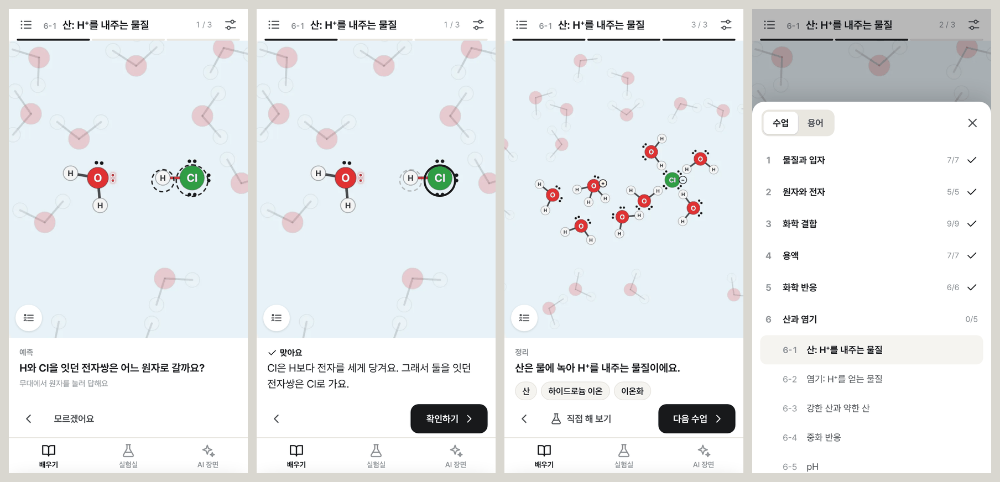

# 교육 과정 (배우기 탭)

상태: 안 · 2026-11-10 · [기획안 개요](README.md)

## 1. 누구에게, 무엇을

- 배우는 사람을 따로 정하지 않는다. 기준은 하나다. 직관적으로 시각화해서 되도록 마찰 없이 익히게 하는 것이다.
- 범위: 중학교 과학의 물질 단원부터 고등학교 화학의 기본 개념까지. 교육과정 문서와 단원을 하나씩 대조하는 일은 작업 목록에 둔다. 아래 표는 그 전의 안이다.
- 수와 양(반응식의 계수, 몰, 농도, pH)도 다룬다. 다만 식을 외우게 하지 않고, 화면에서 직접 세고 견줄 수 있게 그린다. 그렇게 그릴 방법을 찾지 못한 내용은 넣지 않는다.

## 2. 가르치는 원칙

윤범님이 설명에 대해 말씀해 오신 기준을 수업 규칙으로 옮겼다.

1. **수업 하나에 개념 하나, 예 하나.**
2. **목표는 '따라갈 수 있다'로 쓴다.** 정의를 외우는 것으로는 부족하고, 무엇이 어디로 가서 무엇이 되는지 머릿속으로 따라갈 수 있어야 안 것이다. 예: "HCl이 물에 녹을 때 H⁺가 어디로 가는지 따라갈 수 있다."
3. **수준을 낮추지 않고 단계를 잘게 나눈다.** 수업은 앞 수업에서 배운 것만 전제로 삼는다. 전제가 되는 수업을 수업마다 적는다.
4. **정식 용어를 쓰고, 처음 나오는 곳에서 뜻을 같이 준다.** 비유로 끝내지 않는다.
5. **보여 주기 전에 먼저 묻는다.** 예측하고, 보고, 설명을 읽는 순서다. 답이 틀려도 바로 다음 장면이 답을 보여 준다. 점수는 매기지 않는다.
6. **답은 되도록 무대에서 한다.** 원자나 결합을 직접 눌러 답하면, 보기 가운데 하나를 고를 때보다 화면을 자세히 보게 된다.

## 3. 수업 한 편의 구조

| 차례 | 화면 | 내용 |
|---|---|---|
| 1. 질문 | 설명 줄에 물음 하나 | 생활 속 물음으로 시작한다. "소금은 물에 넣으면 왜 안 보일까요?" |
| 2. 장면 | 3~8단계 | 단계마다 변화 하나. 설명은 60자 이하 |
| 3. 예측 | 장면 사이에 1~2번 | 다음 단계를 재생하기 전에 묻는다 |
| 4. 정리 | 한 문장과 새 용어 | 새 용어는 용어집에 모인다 |
| 5. 직접 해 보기 | 실험실로 이동 | 이 수업의 재료로 조건 하나를 바꿔 본다. 해당하는 수업에만 있다 |

예측 질문은 세 가지 유형만 쓴다.

| 유형 | 답하는 방법 | 예 |
|---|---|---|
| 무대에서 고르기 | 원자, 결합, 분자 가운데 하나를 누른다 | "H와 Cl을 잇던 전자쌍은 어느 원자로 갈까요?" |
| 보기에서 고르기 | 보기 2~3개 가운데 하나를 누른다. 무대에서 가리킬 수 없는 것을 물을 때 쓴다 | "온도를 올리면 증발은 빨라질까요, 느려질까요?" |
| 세기 | 수를 답한다 | "반응이 끝나면 산소 원자는 몇 개일까요?" |

진도는 브라우저에 저장한다(계정은 만들지 않는다). 수업을 잠그지 않는다. 목차는 이미 본 수업과 다음에 볼 수업을 표시하고, 전제가 되는 수업을 아직 안 봤으면 수업 첫머리에서 알려 준다.

## 4. 단원과 수업

8단원 51수업이다. '장면' 열의 뜻은 다음과 같다.

- **있음**: 지금 튜토리얼에 있는 장을 수업 형식으로 옮긴다(25편).
- **새 장면**: 지금 엔진으로 그릴 수 있다. 대본과 질문만 쓰면 된다(18편).
- **새 기능**: 엔진에 기능을 더해야 한다(8편).

단원 순서는 앞 단원이 뒤 단원의 전제가 되도록 정했다. 입자가 움직인다는 것(1) → 그 입자 속의 전자(2) → 전자로 원자가 이어지는 방법(3) → 이어진 입자가 물속에서 하는 일(4) → 결합이 바뀌는 일(5) → 그 가운데 H⁺가 옮겨 가는 반응(6), 전자가 옮겨 가는 반응(7), 탄소 화합물의 반응(8).

### 1단원. 물질과 입자

| 수업 | 따라갈 수 있게 되는 것 | 장면 |
|---|---|---|
| 1-1 물을 확대하면 | 물은 분자로, 분자는 원자로 되어 있음을 화면에서 찾는다 | 새 장면 |
| 1-2 입자는 늘 움직인다 | 온도가 오르내리면 입자의 움직임이 어떻게 달라지는지 | 새 장면 |
| 1-3 확산 | 물에 넣은 입자 하나가 퍼져 나가는 경로 | 있음(diffusion) |
| 1-4 분자 사이 인력과 세 가지 상태 | 고체·액체·기체에서 분자 사이 거리와 움직임이 어떻게 다른지 | 있음(forces) |
| 1-5 증발과 응결 | 수면의 물 분자가 공기 중으로 나갔다가 다시 액체로 내려오는 과정 | 있음(evaporation) |
| 1-6 끓음 | 액체 속에서 기포가 생겨 올라오는 과정 | 있음(boiling) |
| 1-7 얼 때와 녹을 때 | 물 분자가 육각형 그물로 이어지고 다시 흐트러지는 과정 | 있음(ice) |

### 2단원. 원자와 전자

| 수업 | 따라갈 수 있게 되는 것 | 장면 |
|---|---|---|
| 2-1 원자 속 | 원자핵과 전자가 어디에 있고, 전하가 어떻게 0이 되는지 | 새 기능: 원자 무대 |
| 2-2 전자 껍질과 원자가 전자 | 전자가 안쪽 껍질부터 들어가고, 가장 바깥 껍질의 전자가 원자가 전자임을 | 새 기능: 원자 무대 |
| 2-3 주기율표 읽기 | 세로줄이 같은 원소는 원자가 전자 수가 같음을 | 새 기능: 주기율표 |
| 2-4 옥텟 규칙 | 비활성 기체가 왜 반응하지 않고, 다른 원자는 왜 바깥 전자 8개를 가지려 하는지 | 새 기능: 원자 무대 |
| 2-5 이온 | 원자가 전자를 잃거나 얻어 이온이 되는 과정 | 새 기능: 원자 무대 |

### 3단원. 화학 결합

| 수업 | 따라갈 수 있게 되는 것 | 장면 |
|---|---|---|
| 3-1 이온 결합 | Na의 전자가 Cl로 가고, 두 이온이 서로 당겨 결정이 되는 과정 | 새 장면 |
| 3-2 공유 결합 | H 원자 둘이 전자를 하나씩 내어 전자쌍 하나를 함께 쓰는 과정 | 새 장면 |
| 3-3 구조식 읽기 | 결합선과 비공유 전자쌍으로 분자를 읽는다 | 있음(atoms) |
| 3-4 이중 결합과 삼중 결합 | O₂, N₂, CO₂에서 전자쌍 몇 개를 함께 쓰는지 | 새 장면 |
| 3-5 전기 음성도와 극성 | 결합 전자쌍이 어느 원자 쪽으로 치우치는지 | 새 기능: 부분 전하 표시 |
| 3-6 분자의 모양 | 전자쌍끼리 반발해서 분자 모양이 정해지는 과정 | 새 장면 |
| 3-7 수소 결합 | 물 분자끼리 유난히 세게 당기는 까닭 | 새 장면 |
| 3-8 배위 결합 | 한 원자가 전자쌍을 통째로 내어 만드는 결합 | 있음(coordination) |
| 3-9 금속 결합 | 금속 원자 사이를 자유 전자가 옮겨 다니는 모습 | 새 기능(2차) |

### 4단원. 용액

| 수업 | 따라갈 수 있게 되는 것 | 장면 |
|---|---|---|
| 4-1 용해 | 물 분자가 이온을 둘러싸서 결정에서 떼어 내는 과정 | 있음(dissolving) |
| 4-2 석출 | 녹아 있던 이온이 다시 결정이 되는 과정 | 있음(precipitation) |
| 4-3 기체가 물에 녹을 때 | CO₂가 수면을 지나 물에 녹고 다시 나오는 과정 | 새 장면 |
| 4-4 삼투 | 물이 막을 지나 녹은 입자가 많은 쪽으로 가는 과정 | 있음(osmosis) |
| 4-5 막 수송 | 이온이 통로와 펌프로 막을 지나는 과정 | 있음(membrane) |
| 4-6 흡착과 이온 교환 | 점토 표면의 이온이 다른 이온과 바뀌는 과정 | 있음(exchange) |
| 4-7 씻겨 내려감 | 이온이 빗물을 따라 아래로 내려가는 과정 | 있음(leaching) |

### 5단원. 화학 반응

| 수업 | 따라갈 수 있게 되는 것 | 장면 |
|---|---|---|
| 5-1 화학 반응이란 | 반응 전과 후에 원자는 그대로이고 결합만 바뀜을 원자 하나하나로 | 새 장면 |
| 5-2 화학 반응식 | 반응식의 계수가 분자 수이고, 양쪽 원자 수가 같음을 | 새 장면(세기 질문) |
| 5-3 전자쌍의 이동과 전하 | 굽은 화살표를 따라 전자쌍과 전하가 옮겨 가는 과정 | 있음(arrows) |
| 5-4 반응과 에너지 | 발열과 흡열, 활성화 에너지를 에너지 그래프에서 | 있음(energy) |
| 5-5 반응이 빨라지는 조건 | 온도, 농도, 촉매가 충돌 횟수와 에너지 언덕을 어떻게 바꾸는지 | 새 장면 |
| 5-6 화학 평형 | 정반응과 역반응이 같은 빠르기로 일어나는 상태 | 있음(equilibrium) |

### 6단원. 산과 염기

| 수업 | 따라갈 수 있게 되는 것 | 장면 |
|---|---|---|
| 6-1 산 | HCl이 물에 녹을 때 H⁺가 어디로 가는지 | 있음(acid-hcl) |
| 6-2 염기 | NH₃가 물에서 H⁺를 얻을 때 물 분자는 무엇이 되는지 | 있음(base-nh3) |
| 6-3 강한 산과 약한 산 | 아세트산 분자 가운데 일부만 H⁺를 내주는 모습 | 새 장면 |
| 6-4 중화 반응 | H₃O⁺와 OH⁻가 물이 되는 과정 | 있음(neutralization) |
| 6-5 pH | H₃O⁺가 많고 적음이 곧 산성과 염기성임을 | 새 장면(세기 질문) |

### 7단원. 산화와 환원

| 수업 | 따라갈 수 있게 되는 것 | 장면 |
|---|---|---|
| 7-1 산화와 환원 | Zn의 전자가 Cu²⁺로 가는 과정 | 있음(redox) |
| 7-2 산화수 | 원자마다 전자를 몇 개 잃고 얻었는지 센다 | 새 장면 |
| 7-3 금속의 반응성 | 어떤 금속이 전자를 더 쉽게 내주는지 | 새 장면 |
| 7-4 전지 | 전자가 도선을 지나게 해서 전류를 얻는 과정 | 있음(cell) |
| 7-5 전기 분해 | 전류로 반응을 거꾸로 일으키는 과정 | 새 기능(2차) |

### 8단원. 탄소 화합물

| 수업 | 따라갈 수 있게 되는 것 | 장면 |
|---|---|---|
| 8-1 탄소 화합물 | 탄소가 결합 네 개로 사슬과 고리를 만드는 모습 | 새 장면 |
| 8-2 작용기 | −OH, −COOH, −NH₂가 분자의 성질을 정함을 | 새 장면 |
| 8-3 라디칼 반응 | 빛이 결합을 깨서 홑전자를 가진 원자가 생기는 과정 | 있음(radical) |
| 8-4 치환 반응 | 원자 하나가 떠나고 다른 원자가 그 위치에 결합하는 과정 | 있음(substitution) |
| 8-5 첨가 반응 | 이중 결합 가운데 하나가 깨지며 원자 둘이 결합하는 과정 | 있음(addition) |
| 8-6 축합과 가수분해 | 물이 빠지며 두 분자가 이어지고, 물이 들어가며 다시 나뉘는 과정 | 있음(condensation) |
| 8-7 고분자 | 같은 축합이 되풀이되어 긴 사슬이 되는 과정 | 새 장면(2차) |

석회 동굴, 리튬 이온 전지, 미토콘드리아, 뿌리털 같은 완성 장면은 교육 과정에 넣지 않는다. 지금처럼 AI 장면 탭의 예시에 둔다. 예시는 목차의 기준이 아니라고 전에 정하신 대로다.

## 5. 수업 자료의 형식

수업은 정해진 항목을 적은 자료 하나다. 재생은 수업 재생기가 하므로, 수업을 쓰는 사람(또는 모델)은 항목만 적으면 된다. 검사는 `npm run check`가 자동으로 한다.

| 항목 | 내용 | 자동 검사 |
|---|---|---|
| 번호, 단원, 제목 | | 번호가 중복되지 않는다 |
| 목표 | '~ 따라갈 수 있다' 한 문장 | '수 있다'로 끝난다 |
| 전제 수업 | 수업 번호 목록 | 실제로 있는 수업이고, 이 수업보다 앞에 있다 |
| 질문 | 생활 속 물음 한 문장 | 물음표로 끝나고 40자 이하다 |
| 대본 | 지금 쓰는 장면 대본 그대로 | 오류 없이 컴파일된다. 3~8단계다. 설명이 60자 이하다 |
| 예측 질문 | 1~2개. 유형, 정답, 해설 | 가리키는 원자와 결합이 그 단계에 실제로 있다. 정답이 후보 안에 있다 |
| 새 용어 | 낱말과 뜻 | 그 낱말이 설명이나 정리에 나온다. 용어집 안에서 중복되지 않는다 |
| 정리 | 한 문장 | 40자 이하다 |
| 직접 해 보기 | 실험실 재료 목록(없어도 된다) | 실험실에 있는 재료다 |
