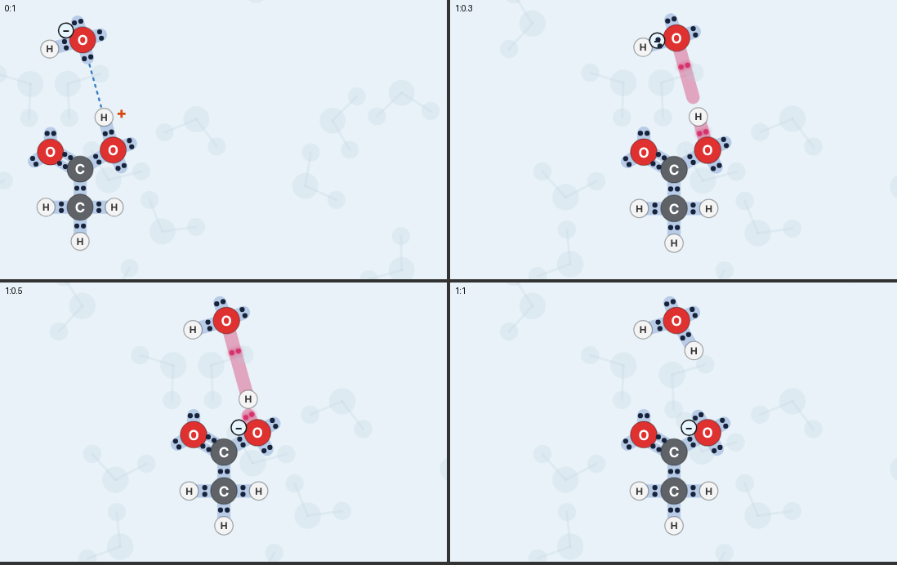
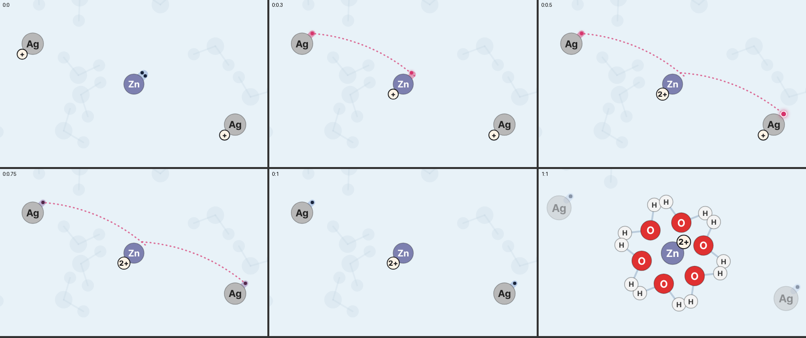
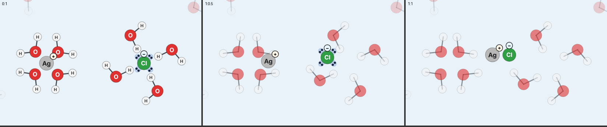
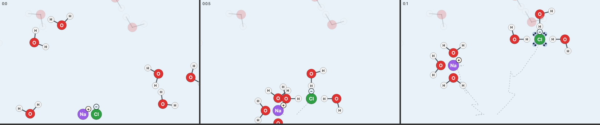

# 실험실 설계서 검토

상태: 검토 끝 · 2026-11-10 · 대상: [lab-astra.md](lab-astra.md) · [기획안 개요](README.md)

## 1. 결론

**판정하는 방법은 그대로 쓴다. 범위와 화면은 고쳐서 쓴다.**

Astra의 설계는 "무엇을 반응한다고 답해도 되는가"를 아주 엄격하게 정했고, 그 부분은 내 초안([lab.md](lab.md))보다 훨씬 낫다. 수치와 대본 예시도 전부 맞았다. 다만 그대로 만들면 화학적으로 틀린 장면은 없지만, 이 앱에서 가장 중요한 것(전자가 움직이는 모습)이 나오는 반응이 아홉 개뿐이고, 윤범님이 처음에 말한 "원소를 직접 넣어 반응시키는 화면"은 없다.

## 2. 직접 확인한 것

| 확인한 것 | 방법 | 결과 |
|---|---|---|
| 대본 예시 일곱 개(A01, A03, A04, P01, D01, R01, R02) | 지금 엔진으로 컴파일 | 오류 없음. 끝 상태의 물질과 전하가 문서의 생성물과 같음 |
| 네 계열이 새 방식에서 보이는 모습 | 비교 화면에서 장면을 찍어 봄 | 아래 사진. 양성자 이동과 금속 치환은 잘 보임. 침전과 용해는 4.4에 적은 문제가 있음 |
| logK 여섯 개, Q/Ksp 네 개, E°cell 세 개, E 범위 여섯 개 | 다시 계산 | 전부 일치. A06만 4.5105와 4.5106으로 마지막 숫자가 다른데 반올림 차이이고 판정에는 영향 없음 |
| Ka, Kb, Ksp, E° 값 | OpenStax Chemistry 2e 부록의 값과 대조 | 같음. 이번에 그 웹 페이지를 다시 읽지는 않았고, 내가 아는 부록 값과 대조했다 |
| "컴파일은 늘 새 장면에서 시작한다" | `src/engine/compile.ts` | 맞음 |
| "`precipitate`는 화학식이 같은 이온 가운데 앞의 것부터 고른다" | `compile.ts`의 `precipitate` | 맞음. 사용자가 고른 이온이 아닌 다른 이온이 고체가 될 수 있다 |
| "아세트산에서 OH의 O는 O2, 그 H는 H4" | A04 컴파일 결과 | 맞음. 끝 상태에서 `a.O2`의 전하가 −1 |

## 3. 그대로 쓰는 것

1. **검토한 자료 행만 실행한다.** 구조를 그릴 수 있다는 사실은 반응한다는 근거가 아니다.
2. **결과는 셋이고, 준비 상태는 따로다.** 반응함 / 반응하지 않음 / 모름. "Zn 하나에 Ag⁺가 하나뿐"은 모름이 아니라 "반응하지만 재료가 모자람"이다.
3. **조작 한 번에 완결된 반응 한 번.** 자동으로 이어지는 반응은 없다. Zn⁺ 같은 중간 상태를 남기지 않는다.
4. **입자 수는 반응식의 계수만 뜻한다.** 농도, 수율, 시간으로 읽게 하지 않는다.
5. **셋째 물질이 있으면 허용 목록으로 검사한다.** 목록에 없는 물질이 무대에 있으면 모름이다.
6. **판정 → 계획 → 엔진 검사의 세 단계.** 대본은 화학을 결정하는 곳이 아니라 결정된 것을 그리는 곳이다.
7. **원자 ID와 전자 총수 보존 검사.** 전자 총수는 `Σ(2×lp + rad) + Σ(2×결합 차수)`.
8. **엔진에 더해야 할 여섯 가지(E1–E6).** 특히 E1(있던 상태에서 이어서 컴파일)과 E2(고른 이온만 침전)는 실험실보다 먼저 만들어야 한다.
9. **단계 0부터 시작.** A01, P01, R02 세 개로 E1·E2, 재료 부족, 도중 취소, 생성물 다시 쓰기를 먼저 증명한다.

## 4. 고쳐서 쓰는 것

### 4.1 범위: 원자로 분자를 만드는 모드를 따로 둔다

Astra는 낱원자를 전부 뺐다. 이유는 옳다. Na 원자와 Cl 원자를 가까이 가져가서 소금이 생기는 장면은 일상에서 일어나는 반응이 아니고, "만들 수 있는 구조"와 "실제로 일어나는 반응"을 섞게 된다. 내 초안의 '원자끼리 결합' 규칙이 바로 그 잘못을 했다.

그런데 전부 빼면 잃는 것이 크다.

- 15개 반응 가운데 전자가 움직이는 것은 양성자 이동 여섯 개와 금속 치환 세 개뿐이다. 침전과 용해에는 전자의 이동이 없다.
- 새 방식에서 가장 알기 쉬운 장면인 "반쪽 주머니 둘이 합쳐져 결합 하나가 되는 것"이 실험실에 한 번도 나오지 않는다.
- 윤범님이 처음 말한 화면은 "원소를 직접 넣어 반응시킬 수 있는 화면"이었다.

그래서 실험실 안에 모드를 둘 둔다.

| 모드 | 하는 말 | 내용 |
|---|---|---|
| 수용액 반응 | "이 조건에서 이 반응이 일어나요" | Astra의 설계 그대로 |
| 분자 조립 | "이 원자들로 이런 분자를 만들 수 있어요" | 비금속 원자(H, C, N, O, F, Cl)를 넣고, 홑전자끼리 짝을 지어 결합을 만든다 |

분자 조립은 플라스틱 분자 모형과 같은 주장만 한다. 반응이 일어난다고 말하지 않으므로 Astra의 반대 이유에 해당하지 않는다. 결과는 셋이다: 앱이 아는 분자("물 분자를 만들었어요"), 전자가 모두 짝을 지었지만 앱이 이름을 모르는 구조("이런 분자가 실제로 있는지는 이 앱이 몰라요"), 아직 짝이 없는 전자가 남은 상태. 금속 원자는 넣지 않는다. 조립한 분자가 수용액 반응의 재료 목록에 있으면(H₂O, NH₃) 그쪽으로 가져갈 수 있다.

엔진에는 이미 필요한 명령(`hop`으로 홑전자 둘이 결합이 되는 것)과 표현(반쪽 주머니)이 있다.

### 4.2 환경: 1차 화면에서는 고르는 것을 없앤다

Astra의 환경 변수는 넷(매질, 온도, 묽기, 가열·빛)이고 그 가운데 사용자가 고를 수 있는 것은 묽기 하나다. 그 선택으로 늘어나는 것은 "아주 묽으면 AgCl이 생기지 않는다"는 판정 세 개뿐인데, 그 대신 배우는 사람은 첫 드래그 전에 '참고 조건'이 무엇인지부터 이해해야 한다.

1차에서는 조건을 **"25 °C의 묽은 물속"** 하나로 고정하고 화면에는 그 한 줄만 보인다. 자료 행에는 Astra가 정한 네 필드를 그대로 적는다(나중에 조건을 늘릴 때 행을 고치지 않기 위해서다). Q/Ksp 계산은 실행 때가 아니라 자료를 검사할 때 한다. 이렇게 하면 T38–T40, T56, T57, S13, S18과 조건을 바꾸는 화면이 1차에서 빠진다.

### 4.3 화면의 글: 한 줄만 보이고 나머지는 '자세히'로

설계서는 무대의 고정 안내, 반응마다의 "정도는 계산하지 않아요", 이온마다의 "반대 이온은 생략" 배지, 모름의 이유 열두 가지를 화면에 쓰게 한다. 하나하나는 옳지만 전부 보이면 장면보다 글을 먼저 읽게 된다.

- 무대에는 한 줄만: "입자 몇 개로 반응 한 번을 봐요."
- 결과에는 제목 한 줄. 까닭과 한계는 '자세히'를 눌렀을 때 보인다.
- 모름의 이유는 코드에서는 열두 가지로 구분하되, 화면의 문장은 넷으로 줄인다: 이 재료는 구조만 볼 수 있어요 / 이 조합은 아직 몰라요 / 다른 재료가 함께 있어서 몰라요 / 얼마나 반응하는지는 계산하지 않아요.

### 4.4 침전: 고체로 보이게 한다

한 쌍만 침전시키면 이온 둘이 나란히 있는 모습이 되고 고체로 보이지 않는다. Astra는 외곽선과 "AgCl 고체 · 화학식 단위 1"이라는 글로 보완하자고 했는데, 글 없이 보이게 하는 편이 낫다.

- 이미 같은 고체가 있으면 새 쌍은 그 고체에 더해진다(`onto`). Astra는 뒤로 미뤄도 된다고 했지만 1차에 포함한다.
- 재료 세트 "고체가 생기기"는 Ag⁺와 Cl⁻를 세 쌍씩 준다. 둘째 쌍부터 결정이 자라는 것이 보인다.

용해 장면에서는 이온이 지나간 흔적(점선)이 지그재그로 남는다. 실험실에 쓰기 전에 고친다.

### 4.5 금속: 원자 하나가 아니라 조각으로 그린다

설계서의 금속은 "표면을 대표하는 원자 하나"다. 화면에서는 물속에 원자 하나가 있는 것처럼 보이고, 금속 치환에서 가장 알기 쉬운 장면(조각에서 원자 하나가 이온이 되어 물로 나가고, 다른 금속 이온이 조각 표면에 원자로 남는 것)이 사라진다. 금속은 원자 여러 개로 된 조각으로 그리고, 반응에 참여하는 것은 그 표면의 원자 하나로 한다. 판정과 자료는 그대로이고 표현만 바뀐다. 반응을 그리는 방식을 확정할 때 함께 정한다.

### 4.6 검토자

설계서는 공개 전에 화학 검토자를 정하라고 하고, 만든 쪽이 스스로 승인하면 안 된다고 한다. 지금 이 프로젝트에는 사람 검토자가 없다. 기본값을 이렇게 둔다.

- 자료 행을 쓴 모델과 다른 모델이 행마다 출처와 대조하고, 대조한 내용을 행에 남긴다. `reviewer`에는 사람 이름이 아니라 '모델 대조'라고 적는다.
- 앱의 '출처' 화면에 "출처와 대조한 자료이고 전문가가 검토한 것은 아니에요"라고 적는다.
- 나중에 화학 교사나 전공자가 검토하면 그때 상태를 올린다.

### 4.7 양

재료 24종, 반응 15개에 시험 80개, 실행 취소 100단계, 확장 번들 형식까지 한 번에 만들 필요는 없다. 설계서의 단계 1(재료 약 15종, 반응 8개)을 첫 목표로 하고, 시험도 그 범위에 해당하는 것만 먼저 만든다. 형식은 처음부터 설계서대로 쓴다.

## 5. 내 초안에서 버리는 것

| 초안의 내용 | 버리는 까닭 |
|---|---|
| 원자끼리 결합을 '반응'으로 판정하는 규칙 | 만들 수 있는 구조와 실제 반응을 섞는다. 분자 조립 모드로 옮긴다 |
| 규칙이 여럿 맞을 때의 우선순위 표 | 근거 없는 반응 순서다. 경쟁하면 모름이다 |
| '반응' 버튼 | 어느 입자끼리 반응하는지 사용자가 고르지 못한다. 드래그로 바꾼다 |
| 가열·빛 조건 칩 | 그 조건에서 일어나는 반응 계열을 따로 설계하기 전에는 판정할 수 없다 |
| "표에 한 줄 더하기"로 범위를 늘린다는 말 | 숫자 한 줄만으로 모든 상대와의 반응이 허용되면 안 된다. 근거·조건·시험을 함께 가진 행을 더한다 |

## 6. 만드는 순서

실험실은 지금 보류 상태다(반응을 그리는 방식을 먼저 확정한다). 시작할 때의 순서는 다음과 같다.

1. 엔진: E1(있던 상태에서 이어서 컴파일), E2(고른 이온만 침전).
2. 단계 0: A01, P01, R02로 재료 부족·도중 취소·생성물 다시 쓰기를 증명.
3. 수용액 반응의 단계 1.
4. 분자 조립.
5. 수용액 반응의 나머지(단계 2).

## 7. 윤범님이 정할 것

- 분자 조립 모드를 넣을지(4.1).
- 사람 검토자를 구할지, 모델 대조로 공개할지(4.6).
