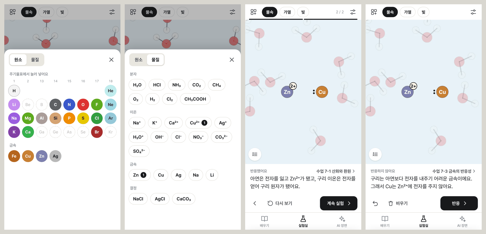
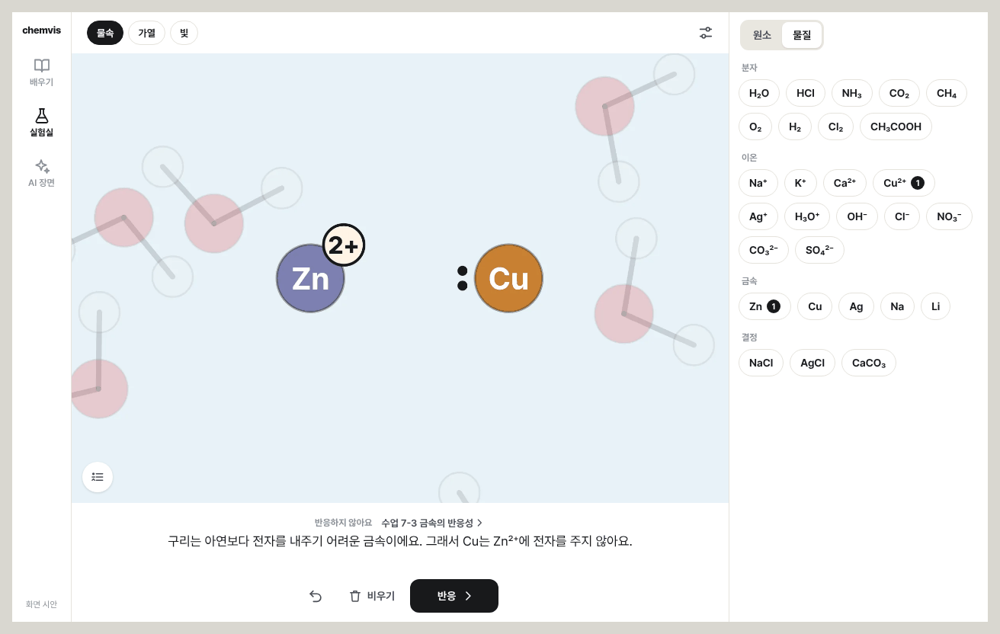

# 실험실

상태: 안 · 2026-11-10 · [기획안 개요](README.md)

## 1. 한 줄로

재료(원소, 분자, 이온, 금속, 결정)와 조건(물속, 가열, 빛)을 고르고 '반응'을 누르면, 앱이 아는 규칙에 따라 일어나는 일을 장면으로 보여 준다.

## 2. 먼저 정해야 하는 것: 앱은 화학을 다 알지 못한다

아무 원소나 섞었을 때 무슨 일이 일어나는지를 모두 계산해 내는 일은 이 앱의 범위를 넘는다. 지금의 엔진도 반응을 계산하지 않는다. 대본에 적힌 대로 그리고, 전자 수와 전하만 검사한다.

그래서 실험실은 **아는 범위 안에서는 정확하게 답하고, 모르면 모른다고 답한다.** 결과는 반드시 다음 셋 가운데 하나다.

| 결과 | 화면에 나오는 것 | 언제 |
|---|---|---|
| 반응했어요 | 장면 재생, 일어난 일의 설명, 그 반응을 배우는 수업 | 규칙이 반응한다고 답했을 때 |
| 반응하지 않아요 | 반응하지 않는 까닭, 그 까닭을 배우는 수업 | 규칙이 반응하지 않는다고 답했을 때. 예: Cu + Zn²⁺ |
| 이 앱이 아직 모르는 조합이에요 | 'AI에게 묻기' | 맞는 규칙이 없을 때 |

셋째를 둘째처럼 말하면 거짓말이 된다. 코드에서 '규칙이 없다'와 '반응하지 않는다'를 서로 다른 값으로 다루고, 이 구분을 검사로 지킨다.

## 3. 넣을 수 있는 것

| 종류 | 넣는 방법 | 1차 범위 |
|---|---|---|
| 원소 | 서랍의 주기율표에서 누른다. 원자는 원자가 전자가 보이는 모습으로 무대에 나타난다 | H, Li, C, N, O, F, Na, Mg, Al, Si, P, S, Cl, K, Ca, Br, 비활성 기체 He·Ne·Ar, 금속 Fe·Cu·Zn·Ag |
| 물질 | 서랍의 목록에서 누른다 | 지금 앱에 등록된 분자, 이온, 금속, 결정 |
| 조건 | 위 줄의 칩 | 물속(기본) 또는 공기 중, 가열, 빛 |
| 수 | 한 번 누를 때마다 하나 | 종류마다 6개까지 |

## 4. 반응 규칙

규칙 하나는 "무대에 무엇이 있으면 무슨 일이 일어나는가"를 적은 것이고, 일어나는 일을 대본 단계로 만들어 낸다. 그리는 일은 지금의 대본 엔진이 그대로 한다. 따라서 실험실의 장면은 배우기나 AI 장면의 장면과 똑같이 보인다.

### 1차 규칙 (이번 주)

| 규칙 | 판단에 쓰는 표 | 예 | 관련 수업 |
|---|---|---|---|
| 원자끼리 결합 | 원자가 전자 수, 금속·비금속 구분 | Na + Cl → Na⁺와 Cl⁻(전자 이동). H + H → H₂(전자쌍 공유). He는 반응하지 않는다 | 2-4, 3-1, 3-2 |
| H⁺ 이동 | 산의 세기 표 | HCl + H₂O, HCl + NH₃, H₃O⁺ + OH⁻ | 6-1 ~ 6-4 |
| 이온끼리 석출 | 용해도 표 | Ag⁺ + Cl⁻는 AgCl로 석출된다. Na⁺ + Cl⁻는 녹은 채로 있다 | 4-2 |
| 결정의 용해 | 용해도 표 | NaCl은 녹고 AgCl은 녹지 않는다 | 4-1 |
| 금속과 금속 이온 | 금속의 반응성 순서 | Zn + Cu²⁺는 반응한다. Cu + Zn²⁺는 반응하지 않는다 | 7-1, 7-3 |

### 2차 규칙 (다음 주부터)

금속 + 산 → 수소 기체, 빛 + 할로젠 분자 → 라디칼, 가열 → 증발과 끓음, 냉각 → 얼음, 축합, 연소(전자의 움직임은 생략하고 전체 반응으로).

규칙이 여럿 맞으면 우선순위 표에 따라 하나만 적용한다. 반응이 끝난 뒤 '반응'을 다시 누르면 남은 재료에 다음 규칙이 적용된다.

## 5. 화면

- **위 줄**: 재료 서랍 버튼, 조건 칩.
- **설명 줄**: 반응 전에는 무대에 있는 재료 목록, 반응 뒤에는 결과.
- **조작 줄**: 실행 취소, 비우기, 반응(주 버튼). 반응이 재생되는 동안에는 다른 탭과 같은 이전·다시 보기·다음으로 바뀐다.
- **재료 서랍**: 왼쪽 위 버튼 하나로만 펼친다. 같은 일을 하는 버튼을 둘 두지 않기 위해서다. 무대가 비어 있으면 서랍이 펼쳐진 채로 시작한다. PC에서는 서랍이 오른쪽에 늘 보인다.
- **무대에서**: 재료를 누르면 이름과 '빼기'가 나온다. 드래그하면 위치가 바뀐다.

## 6. 분자를 손으로 만드는 기능 (2차)

원자의 홑전자끼리 직접 이어서 결합을 만드는 기능이다. 1차에서는 '반응'을 누르면 앱이 규칙에 따라 가까운 원자끼리 결합시킨다. 손으로 잇는 기능은 무대 위 편집 조작이 더 필요해서 2차로 미룬다.

## 7. 다음 주부터 늘리는 방법

실험실은 표와 규칙으로 되어 있어서, 범위를 늘리는 일이 대부분 "표에 한 줄 더하기"다.

- 산 하나 추가: 산의 세기 표에 한 줄.
- 이온 하나 추가: 용해도 표에 한 줄.
- 금속 하나 추가: 반응성 순서에 한 줄.
- 규칙 하나 추가: 본보기 규칙을 복사해서 고친다.

표의 값은 출처를 같이 적고, 줄을 더할 때마다 그 줄을 쓰는 검사 하나를 같이 더한다. 절차는 [handoff.md](handoff.md)에 있다.
