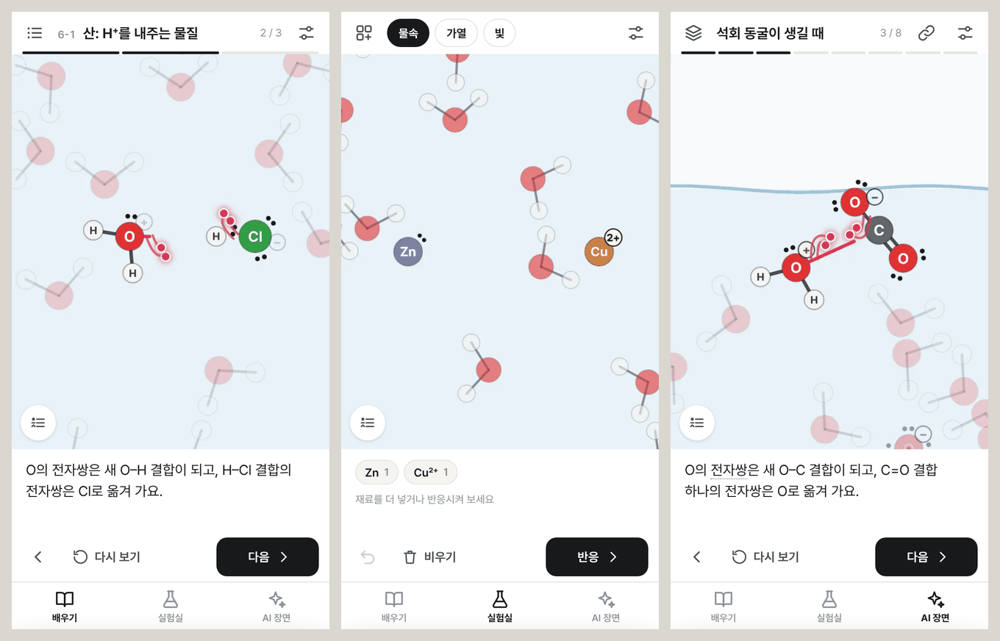
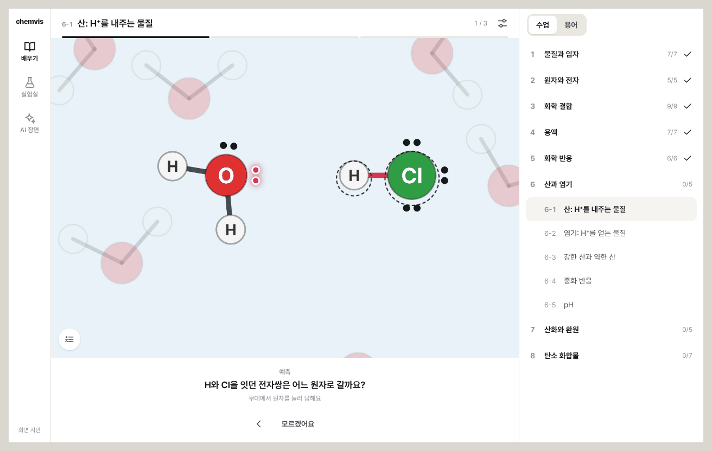

# 화면 구상

상태: 안 · 2026-11-10 · [기획안 개요](README.md)

이 문서는 화면의 뼈대(탭, 영역, 버튼)를 다룬다. 무대 안에서 반응을 그리는 방식은 [depiction.md](depiction.md)에 있고, 그쪽이 먼저다. 아래 규칙 가운데 폰을 먼저 만든다는 R16은 "PC를 먼저"로 바꿨다.

## 1. 지금까지 어긋난 까닭

지난 작업에서 되풀이된 문제는 다음과 같다.

- 버튼 하나가 상황에 따라 다른 일을 했다(재생 버튼).
- 같은 일을 하는 버튼이 둘 생겼다(재생과 다시 보기).
- 폰 화면을 나중에 맞췄다(범례 위치, 화면 밖으로 나간 목록).
- 글이 많았다.
- 코드만 보고 끝냈고, 실제 크기의 화면을 보지 않았다.

원인은 하나다. 화면 전체를 정하는 규칙이 없어서, 기능을 넣을 때마다 위치와 모양을 새로 정했다. 그래서 규칙을 먼저 정한다. 새 기능은 규칙에 이미 있는 영역 안에 넣는다.

## 2. 구상: 무대 하나와 줄 넷

화면은 위에서 아래로 다섯 영역이다. 영역마다 답하는 물음이 하나씩 있다.

| 영역 | 답하는 물음 | 있는 것 | 폰에서의 높이 |
|---|---|---|---|
| 위 줄 | 지금 어디인가 | 서랍 버튼, 제목 또는 조건, 진행 줄, 도구 | 48px |
| 무대 | | 장면, 범례 버튼 | 남는 높이 전부 |
| 설명 줄 | 지금 무슨 일이 일어나는가 | 설명 또는 질문. 세 줄까지 | 94px(고정) |
| 조작 줄 | 지금 무엇을 할 수 있는가 | 버튼 셋까지. 주 버튼은 오른쪽 끝에 하나 | 56px |
| 탭 | 어느 화면으로 갈 수 있는가 | 배우기, 실험실, AI 장면 | 54px |

그 밖의 모든 것(목차, 재료, 장면 목록, 대본)은 **서랍**에 넣는다. 서랍은 탭마다 하나뿐이다. 폰에서는 아래에서 올라오고, PC에서는 오른쪽에 늘 보인다.

세 탭은 같은 영역을 다음과 같이 쓴다. 새 기능을 넣을 때는 이 표의 어느 영역에 둘지부터 정한다. 둘 곳이 없으면 만들지 않고, 먼저 이 문서를 고친다.

| 영역 | 배우기 | 실험실 | AI 장면 |
|---|---|---|---|
| 서랍 버튼 | 목차 | 재료 | 장면 목록 |
| 위 줄 가운데 | 수업 번호와 제목 | 조건(물속, 가열, 빛) | 장면 제목 |
| 위 줄 오른쪽 | 보기 설정 | 보기 설정 | 링크, 보기 설정 |
| 설명 줄 | 단계 설명, 예측 질문, 정리 | 재료 목록, 결과 | 단계 설명 |
| 조작 줄 | 이전 · 다시 보기 · 다음 | 실행 취소 · 비우기 · 반응 (재생 중에는 이전 · 다시 보기 · 다음) | 이전 · 다시 보기 · 다음 |
| 서랍 | 수업, 용어 | 원소, 물질 | 예시, 내 장면, 대본 |

PC에서는 탭이 왼쪽으로, 서랍이 오른쪽으로 간다. 나머지 영역은 순서와 내용이 같다.

## 3. 규칙

번호는 검사 코드와 다른 문서에서 이 규칙을 가리킬 때 쓴다.

### 배치

- **R1** 첫 화면은 언제나 무대다. 목록이나 메뉴만 있는 화면을 만들지 않는다.
- **R2** 무대 높이는 화면 높이의 55% 이상이다(폰 360×640 기준).
- **R3** 무대 크기는 재생 중에 바뀌지 않는다. 설명 줄의 높이가 고정인 까닭이다.
- **R4** 무대 위에 올라가는 것은 범례 버튼, 용어 카드, 질문의 후보 표시뿐이다.
- **R5** 목록은 서랍 안에만 둔다. 팝오버는 보기 설정과 범례에만 쓴다.

### 버튼

- **R6** 한 가지 일에는 버튼 하나. 같은 일을 하는 버튼을 둘 두지 않는다.
- **R7** 버튼 하나는 한 가지 일만 한다. 상황에 따라 하는 일이 바뀌는 버튼은 글자로 그 일을 보여 준다(다음 → 정리 → 다음 수업).
- **R8** 화면마다 주 버튼(먹색 버튼)은 하나이고, 조작 줄의 오른쪽 끝에 있다. 서랍 안에는 주 버튼이 없다. 서랍에서는 고르면 바로 적용된다.
- **R9** 누르는 곳은 모두 가로세로 44px 이상이다.
- **R10** 글자는 줄인다. 아이콘만으로 뜻이 분명한 버튼(이전, 실행 취소, 보기 설정, 범례, 링크, 서랍)은 아이콘만 쓰고 이름은 툴팁에 둔다. 주 버튼과 그 옆의 버튼에는 글자를 같이 쓴다.

### 글과 색

- **R11** 설명은 60자 이하이고, 한 단계에 한 가지 일만 쓴다. 꼬리표(예측, 정리, 반응했어요)가 있으면 40자 이하다.
- **R12** 글자 크기는 네 가지(12, 14, 16, 18px), 굵기는 두 가지만 쓴다.
- **R13** 화면 뼈대는 무채색이다. 색은 무대 안에서만 뜻이 있다(원소의 색, 전자의 분홍색). 주 버튼과 지금 위치는 먹색으로 표시한다.
- **R14** 정답과 오답을 빨강과 초록으로 표시하지 않는다. 산소와 염소의 색과 헷갈리기 때문이다. 글과 ✓ 표시로 알린다.
- **R15** 용어에는 점선 밑줄을 긋는다. 누르면 뜻과 그 용어를 배우는 수업이 나온다.

### 폰과 PC

- **R16** PC 화면을 먼저 제대로 만들고, 폰 화면은 그것을 고쳐서 만든다.
- **R17** PC(폭 900px 이상)에서는 탭이 왼쪽으로, 서랍이 오른쪽으로 간다.
- **R18** 무대에서 답을 고르는 질문에서는 후보끼리 화면에서 40px 이상 떨어져 있어야 한다. 가까우면 카메라가 더 확대한다. 누른 곳에서 가장 가까운 후보가 선택된다.

## 4. 부품

화면은 아래 부품만으로 만든다. 새 부품이 필요하면 이 목록에 먼저 추가한다.

| 부품 | 쓰는 곳 |
|---|---|
| 아이콘 버튼 | 위 줄의 도구, 이전, 실행 취소 |
| 글자 버튼 | 다시 보기, 비우기, 직접 해 보기 |
| 주 버튼 | 조작 줄 오른쪽 끝 |
| 칩 | 조건, 재료, 새 용어 |
| 둘셋 가운데 고르기 | 서랍 머리(수업·용어, 원소·물질, 예시·내 장면·대본) |
| 목록 줄 | 서랍 안의 수업, 장면 |
| 진행 줄 | 위 줄 아래쪽 가장자리. 단계마다 한 토막 |
| 서랍 | 탭마다 하나 |
| 팝오버 | 보기 설정, 범례 |
| 용어 카드 | 무대 아래쪽. 용어를 눌렀을 때 |
| 알림 한 줄 | "링크를 복사했어요" 같은 짧은 알림 |

## 5. 기계가 지키는 것과 눈으로 보는 것

글로 쓴 규칙은 잊히기 쉽다. 그래서 검사할 수 있는 규칙은 모두 검사로 만든다.

| 규칙 | 지키는 방법 |
|---|---|
| R2, R9, R16, R17 | 화면 검사: 폰 2종과 PC 크기에서 무대 높이, 누르는 곳의 크기, 화면 밖으로 나간 것이 없는지 잰다 |
| R3 | 화면 검사: 단계마다 무대의 크기를 재서 같은지 본다 |
| R6 | 화면 검사: 한 화면에 같은 일(`data-act` 값)을 하는 버튼이 둘 있으면 실패 |
| R8 | 화면 검사: 화면마다 주 버튼이 정확히 하나인지 센다 |
| R11 | 자료 검사: 모든 수업과 예시의 설명 길이를 잰다 |
| R12, R13 | 코드 검사: 색과 글자 크기는 정해 둔 변수로만 쓴다. 변수 파일 밖에 색 값이 있으면 실패 |
| R18 | 자료 검사: 질문마다 후보 사이의 화면 거리를 계산한다 |
| R1, R4, R5, R7, R10, R14, R15 | 화면 사진: 모든 화면을 폰과 PC 크기로 찍어 기준 사진 옆에 나란히 두고 눈으로 본다 |

## 6. 시안에 아직 없는 것

- **어두운 화면**: 지금 앱처럼 지원한다. 시안은 밝은 화면만 만들었다.
- **멀리 떨어진 분자**: 한 단계에 나오는 분자들이 서로 멀면 폰에서 원자가 작게 보인다. 지금 앱에도 있는 문제다. 뼈대를 만들 때 "주인공 원자의 화면 지름은 20px 이상"이라는 카메라 규칙으로 고친다.
- **무대 확대와 이동**: 실험실에서 재료가 많아지면 필요하다. 2차로 둔다.
